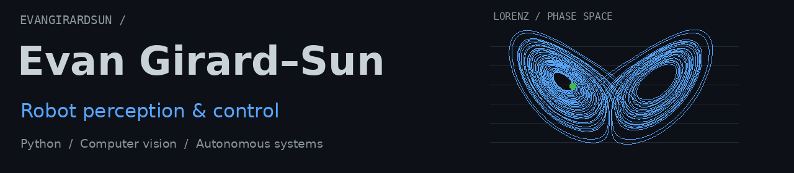
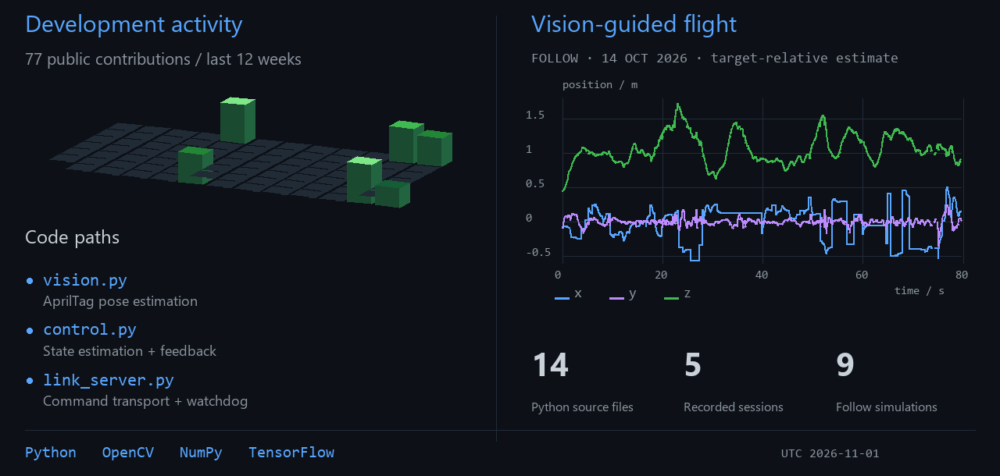

<picture>
  <source media="(prefers-color-scheme: dark) and (prefers-reduced-motion: reduce)" srcset="assets/research-header-dark.png">
  <source media="(prefers-color-scheme: light) and (prefers-reduced-motion: reduce)" srcset="assets/research-header-light.png">
  <source media="(prefers-color-scheme: light)" srcset="assets/research-header-light.gif">
  
</picture>

  <a href="https://evangirardsun.com/">Portfolio ↗</a> &nbsp; / &nbsp;
  <a href="mailto:evangirard50@gmail.com">Email</a> &nbsp; / &nbsp;
  <a href="https://www.linkedin.com/in/evan-girard-sun/">LinkedIn</a>

I work on software that connects what a robot sees to how it moves. My current focus is camera-based drone control, from pose estimation to closed-loop flight.

<picture>
  <source media="(prefers-color-scheme: light)" srcset="assets/research-dashboard-light.png">
  
</picture>

### Camera-based drone autonomy

`2026` · [Phi Lab](https://github.com/EvanGirardSun/phi-lab-autonomy) · [Flight footage ↗](https://evangirardsun.com/assets/phi-follow-v5.mp4)

AprilTag pose estimation from a stock Air75's video feed, with a state filter and feedback controller running on a laptop. A separate command process handles the CRSF link and stale-input watchdog. Collaborative research code, with a simulator and recorded-flight analysis.

| Read the code | Implementation |
| :--- | :--- |
| [vision.py](https://github.com/EvanGirardSun/phi-lab-autonomy/blob/main/vision.py) | Fisheye geometry, tag detection and PnP pose estimation |
| [control.py](https://github.com/EvanGirardSun/phi-lab-autonomy/blob/main/control.py) | State estimation and mission logic; body-frame feedback control |
| [tests/](https://github.com/EvanGirardSun/phi-lab-autonomy/tree/main/tests) | Synthetic calibration tests, follow simulations and fake-device integration tests |

 &nbsp; [Architecture](https://github.com/EvanGirardSun/phi-lab-autonomy/blob/main/docs/architecture.md) · [Flight logs](https://github.com/EvanGirardSun/phi-lab-autonomy/blob/main/docs/flights.md)

### Learning to drive from camera images

`2023` · [Autonomous mini-vehicle](https://github.com/EvanGirardSun/autonomous-mini-vehicle)

An earlier WRO team project using DonkeyCar and TensorFlow. Camera images paired with driving commands fed a behavioral-cloning training pipeline. I worked on model training and vehicle integration; the original Python source and project journal are preserved.

[Training and driving code](https://github.com/EvanGirardSun/autonomous-mini-vehicle/tree/main/FEV-WRO%202023-Future%20Engineers/src) · [Project notes](https://github.com/EvanGirardSun/autonomous-mini-vehicle#readme)

More project footage and engineering work at [evangirardsun.com](https://evangirardsun.com/).
