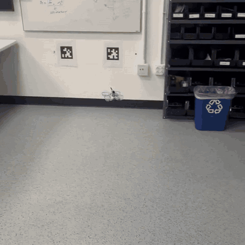

# Evan Girard-Sun

I work on robot perception and control, currently exploring camera-based autonomy for small drones.

[Portfolio ↗](https://evangirardsun.com/) &nbsp; / &nbsp; [Email](mailto:evangirard50@gmail.com) &nbsp; / &nbsp; [LinkedIn](https://www.linkedin.com/in/evan-girard-sun/)

## Camera-based drone autonomy

`2026` · [Phi Lab](https://github.com/EvanGirardSun/phi-lab-autonomy) · [Flight footage ↗](https://evangirardsun.com/assets/phi-follow-v5.mp4)

AprilTag pose estimation and closed-loop control for a stock Air75. Vision runs on a laptop; a separate process handles the radio link and rejects stale commands. Collaborative research at Phi Lab, with offline simulation and recorded-flight analysis.

  <a href="https://github.com/EvanGirardSun/phi-lab-autonomy">
    <picture>
      <source media="(prefers-reduced-motion: reduce)" srcset="assets/follow.png">
      
    </picture>
  </a>

| Read the code | Implementation |
| :--- | :--- |
| [vision.py](https://github.com/EvanGirardSun/phi-lab-autonomy/blob/main/vision.py) | Fisheye geometry, tag detection and PnP pose estimation |
| [control.py](https://github.com/EvanGirardSun/phi-lab-autonomy/blob/main/control.py) | State estimation and mission logic; body-frame feedback control |
| [tests/](https://github.com/EvanGirardSun/phi-lab-autonomy/tree/main/tests) | Synthetic calibration tests, follow simulations and fake-device integration tests |

 &nbsp; [Architecture](https://github.com/EvanGirardSun/phi-lab-autonomy/blob/main/docs/architecture.md) · [Flight logs](https://github.com/EvanGirardSun/phi-lab-autonomy/blob/main/docs/flights.md)

## Learning to drive from camera images

`2023` · [Autonomous mini-vehicle](https://github.com/EvanGirardSun/autonomous-mini-vehicle)

An earlier WRO team project using DonkeyCar and TensorFlow. Camera images paired with driving commands fed a behavioral-cloning training pipeline. I worked on model training and vehicle integration; the original Python source and project journal are preserved.

[Training and driving code](https://github.com/EvanGirardSun/autonomous-mini-vehicle/tree/main/FEV-WRO%202023-Future%20Engineers/src) · [Project notes](https://github.com/EvanGirardSun/autonomous-mini-vehicle#readme)

More project footage and engineering work at [evangirardsun.com](https://evangirardsun.com/).
