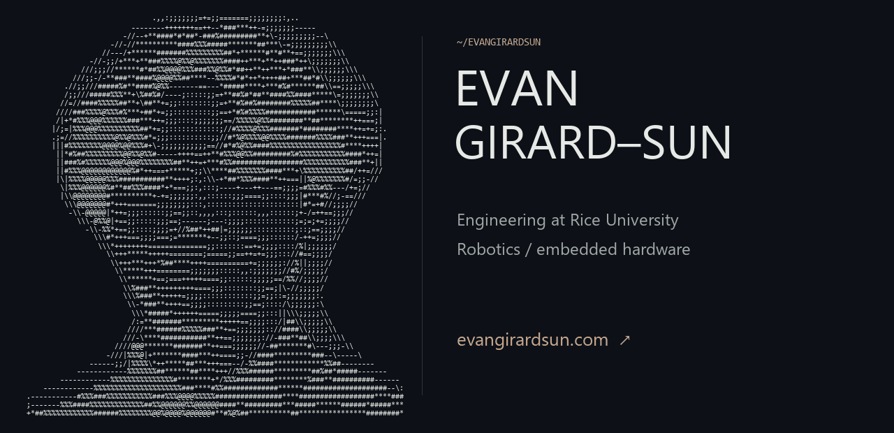

<a href="https://evangirardsun.com/">
  <picture>
    <source media="(prefers-color-scheme: dark) and (prefers-reduced-motion: reduce)" srcset="assets/header-dark.png">
    <source media="(prefers-color-scheme: light) and (prefers-reduced-motion: reduce)" srcset="assets/header-light.png">
    <source media="(prefers-color-scheme: light)" srcset="assets/header-light.gif">
    
  </picture>
</a>

I'm an engineering student at Rice University interested in robotics and embedded hardware. I work across software and physical design, including CAD for competition robots. I currently research camera-based drone control at Phi Lab.

[Portfolio ↗](https://evangirardsun.com/) · [Email](mailto:evangirard50@gmail.com) · [LinkedIn](https://www.linkedin.com/in/evan-girard-sun/)

### Selected work

**[FireWatch](https://github.com/EvanGirardSun/firewatch)**  
Drone-mounted fire and smoke detection. Hardware integration and field demonstrations; autonomous patrol remains in development.

**[FRC mechanical design](https://github.com/EvanGirardSun/frc-mechanical)**  
Complete robot CAD and manufacturing direction, with working intake and launcher demonstrations.

**[Central ECU](https://github.com/EvanGirardSun/central-ecu)**  
An STM32 Nucleo carrier board for Rice Electric Vehicle. Native KiCad files and a reproducible archive check; design under review.

**[Autonomous mini-vehicle · 2023](https://github.com/EvanGirardSun/autonomous-mini-vehicle)**  
An earlier WRO team project using DonkeyCar with Raspberry Pi and EV3. Original source and engineering journal.

<details>
<summary>About the portrait</summary>

The portrait is made from actual text characters mapped from my headshot. Directional strokes follow stronger image edges. The light and dark headers are generated locally; a static image is used when reduced motion is preferred.

[Character portrait](assets/portrait.txt) · [Converter](tools/portrait.py) · [Full-size static header](assets/header-dark.png)

```sh
python -m pip install -r requirements.txt
python tools/build_header.py --animate
python -m unittest discover -s tests -v
```

The scripts look for a local monospace font on Windows, Linux, or macOS. For the standalone converter, use `--font /path/to/monospace.ttf` if one is not found. The portrait input is in `assets/portrait-source.png`.

</details>
